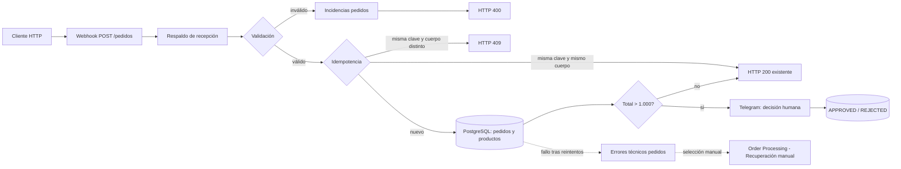

# n8n Order Processing

Flujo de recepción y procesamiento de pedidos con n8n, PostgreSQL y Telegram. Este repositorio reúne los exports de workflows, migraciones SQL, muestras y evidencia de una prueba técnica desarrollada por objetivos ODD.

> **Estado:** pensado para revisión y pruebas controladas. Los exports no incluyen credenciales. Importar un workflow no lo activa; publicar en un entorno compartido requiere una decisión explícita del operador.

## Índice

- [Alcance y arquitectura](#alcance-y-arquitectura)
- [Requisitos y archivos](#requisitos-y-archivos)
- [Preparar una instancia](#preparar-una-instancia)
- [Importar workflows](#importar-workflows)
- [Configurar PostgreSQL](#configurar-postgresql)
- [Configurar Telegram y ngrok](#configurar-telegram-y-ngrok)
- [Contrato HTTP](#contrato-http)
- [Ejecutar pruebas reproducibles](#ejecutar-pruebas-reproducibles)
- [Aprobación, rechazo y recuperación](#aprobación-rechazo-y-recuperación)
- [Resultados y límites de la evidencia](#resultados-y-límites-de-la-evidencia)
- [Decisiones técnicas y uso de Codex](#decisiones-técnicas-y-uso-de-codex)
- [Qué mejoraría con más tiempo](#qué-mejoraría-con-más-tiempo)
- [Seguridad y privacidad](#seguridad-y-privacidad)
- [Documentación y capturas](#documentación-y-capturas)

## Alcance y arquitectura

`POST /pedidos` valida la entrada, conserva el original, registra las incidencias, persiste pedidos y productos en PostgreSQL y, para totales mayores a 1.000, espera una decisión humana en Telegram. El workflow auxiliar permite recuperar manualmente determinados fallos de PostgreSQL a partir de su recepción.



La respuesta HTTP para pedidos válidos se emite tras guardar el pedido. En pedidos sujetos a aprobación, recibir HTTP 200 no confirma que Telegram haya entregado el mensaje ni que exista una decisión.

## Requisitos y archivos

| Componente | Uso |
| --- | --- |
| n8n 2.47.7 | Importar y ejecutar workflows |
| PostgreSQL | Pedidos, productos e idempotencia |
| Telegram | Solicitud de aprobación y decisión humana |
| PowerShell 5.1 o posterior | Pruebas HTTP, sin módulos adicionales |
| ngrok (opcional) | URL HTTPS pública temporal para webhooks de Telegram |

| Ruta | Contenido |
| --- | --- |
| [`workflows/order-processing.json`](workflows/order-processing.json) | Recepción y procesamiento de pedidos |
| [`workflows/order-recovery.json`](workflows/order-recovery.json) | Recuperación manual de fallos PostgreSQL |
| [`sql/objetivo-4.2.sql`](sql/objetivo-4.2.sql), [`sql/objetivo-5.sql`](sql/objetivo-5.sql), [`sql/objetivo-6.sql`](sql/objetivo-6.sql) | Migraciones incrementales |
| [`samples/`](samples/) | Pedidos de ejemplo, prueba PowerShell y evidencia por objetivo |
| [`docs/images/README.md`](docs/images/README.md) | Política y estado de capturas verificadas |

## Preparar una instancia

1. Usa una instancia de prueba de n8n y una base PostgreSQL no productiva.
2. Comprueba que dispones de los permisos para crear tablas de datos en n8n, tablas/índices en PostgreSQL y configurar credenciales propias.
3. Aplica las migraciones en orden: `sql/objetivo-4.2.sql`, `sql/objetivo-5.sql`, `sql/objetivo-6.sql`. Si el esquema inicial no está vacío, compara primero sus columnas y datos con la migración correspondiente.
4. Crea en n8n las Data Tables descritas en [Importar workflows](#importar-workflows).
5. Importa los exports y asigna tus propias credenciales y Chat ID. Mantén los workflows inactivos hasta completar la configuración y pruebas controladas.

Las migraciones 4.2–6 describen cambios incrementales sobre el esquema de la prueba. No son una instalación universal ni deben aplicarse a ciegas sobre una base existente.

## Importar workflows

En n8n, importa cada archivo JSON desde la sección de workflows. Revisa los nodos de credenciales y Data Tables que requieran selección local antes de ejecutar.

Configura estas tablas de n8n con columnas de tipo texto:

| Tabla | Columnas |
| --- | --- |
| `Incidencias pedidos` | `pedido`, `motivos` |
| `Respaldo pedidos` | `pedido`, `idempotency_key`, `recepcion_id` |
| `Errores técnicos pedidos` | `origen`, `recepcion_id`, `pedido`, `detalle` |

Los IDs de tablas presentes en un export pertenecen al entorno que lo generó. En otra instancia, selecciona las tablas locales en los nodos correspondientes. No edites el JSON para insertar credenciales.

## Configurar PostgreSQL

Configura una credencial PostgreSQL propia en los nodos `Guardar pedido`, `Registrar decisión` y los nodos de persistencia/recuperación asociados. La conexión debe poder acceder al esquema `public` y a las tablas `pedidos` y `productos`.

Aplica las migraciones en secuencia y verifica el estado del esquema antes de importar datos de prueba. La migración 6 añade campos e índices parciales únicos para recepción e idempotencia; los registros anteriores conservan los valores nuevos como desconocidos (`NULL`). Los nodos usan parámetros para los valores SQL.

No guardes contraseñas, cadenas de conexión ni dumps de datos en el repositorio. Consulta [`sql/`](sql/) para el esquema exacto de cada objetivo.

## Configurar Telegram y ngrok

1. Crea/configura la credencial del bot Telegram directamente en n8n y añade el Chat ID autorizado al nodo `Solicitar aprobación`. El export deja vacío ese dato.
2. La persona que recibe la solicitud debe poder abrir los botones de decisión.
3. Si n8n es local y Telegram no puede acceder a sus webhooks, inicia un túnel HTTPS dirigido al puerto local de n8n, por ejemplo `ngrok http 5678` (ajusta el puerto al entorno).
4. Configura `N8N_WEBHOOK_URL` con la URL HTTPS del túnel y `N8N_PROXY_HOPS=1` cuando ngrok sea el proxy situado delante de n8n. El último proxy debe enviar `X-Forwarded-For`, `X-Forwarded-Host` y `X-Forwarded-Proto`. Reinicia n8n para aplicar cambios y mantén el túnel activo mientras haya aprobaciones pendientes.
5. Envía un pedido de prueba superior a 1.000 y comprueba que Telegram recibe los botones. Decide aprobar o rechazar desde Telegram.

El dominio temporal de ngrok puede cambiar al reiniciar el túnel. No publiques URLs temporales, tokens del bot ni Chat IDs. La guía oficial de n8n para [webhooks detrás de un proxy](https://docs.n8n.io/hosting/configuration/configuration-examples/webhook-url/) detalla las variables y cabeceras; consulta también la [CLI de ngrok](https://ngrok.com/docs/gateway/agent/cli) para el reenvío HTTP.

## Contrato HTTP

| Elemento | Valor |
| --- | --- |
| Método y ruta | `POST /webhook/pedidos` en producción; `/webhook-test/pedidos` en modo de prueba |
| Content-Type | `application/json` |
| Cabecera opcional | `Idempotency-Key: <clave>` |
| Pedido aceptado | HTTP 200, `{"mensaje":"Pedido recibido"}` |
| Pedido inválido | HTTP 400 con `mensaje` y lista `motivos` |
| Clave ya usada con distinto contenido | HTTP 409 |
| Fallo técnico persistente de PostgreSQL | HTTP 503 |

El cuerpo debe contener `cliente`, `email`, `productos` (al menos uno con `nombre`, `cantidad` positiva y `precio` numérico) y `total` numérico. El total debe coincidir exactamente con la suma de cantidad por precio, expresada en centavos. El umbral es estricto: total `1.000` se procesa automáticamente; total `1.000,01` (o cualquier valor numérico mayor a 1.000) requiere aprobación.

`Idempotency-Key` distingue un reintento del mismo pedido. Repetir clave y contenido conserva un único pedido; repetir clave con contenido diferente produce conflicto. Sin cabecera, dos solicitudes independientes con igual cuerpo producen dos recepciones. No reutilices claves entre pruebas.

## Ejecutar pruebas reproducibles

El script usa únicamente PowerShell/.NET incluidos y HTTP al webhook; no instala módulos ni herramientas adicionales. Cada ejecución crea pedidos e incidencias de muestra, así que debe apuntar a una base aislada. El webhook de prueba necesita una ejecución manual en n8n y puede no servir para la secuencia completa; para ejecutar el conjunto, usa `/webhook/pedidos` en una instancia de prueba ya preparada.

```powershell
$env:ODD_PEDIDOS_WEBHOOK = 'https://<host-n8n>/webhook/pedidos'
.\samples\probar-objetivo-7.ps1
```

El script no activa workflows ni cambia la configuración. Ejecuta estos casos y verifica sus códigos HTTP:

| Caso | Muestra | Resultado |
| --- | --- | --- |
| Pedido válido de total bajo | [`pedido.json`](samples/pedido.json) | 200 |
| Email/cantidad/total inválidos | [`pedido-invalido.json`](samples/pedido-invalido.json) | 400 y motivos |
| Límite exacto | [`limite-1000.json`](samples/limite-1000.json) | 200; `PROCESSED` |
| Sobre el límite | [`limite-1001.json`](samples/limite-1001.json) | Con `-IncluirTelegram`: 200 y solicitud; `PENDING_APPROVAL` hasta decisión |
| Misma clave y mismo cuerpo | [`idempotencia.json`](samples/idempotencia.json) | 200 en ambos intentos |
| Misma clave y cuerpo distinto | [`idempotencia-conflicto.json`](samples/idempotencia-conflicto.json) | 409 |

Opcionalmente añade `-IncluirTelegram` para enviar también los casos superiores al umbral, aprobación y rechazo de [`limite-1001.json`](samples/limite-1001.json), [`aprobacion.json`](samples/aprobacion.json) y [`rechazo.json`](samples/rechazo.json). Estos casos crean registros de prueba y envían notificaciones reales. El script advertirá y pausará para que una persona decida en Telegram. La comprobación del estado final se hace en la base de prueba y en la evidencia de ejecución n8n; el webhook responde antes de completar esa interacción.

```powershell
.\samples\probar-objetivo-7.ps1 -IncluirTelegram
```

La recuperación es manual y solo aplica después de un fallo técnico PostgreSQL registrado. No se fuerza una indisponibilidad ni se simula una incidencia cambiando consultas o credenciales. Sigue [Aprobación, rechazo y recuperación](#aprobación-rechazo-y-recuperación) para validarla cuando exista una recepción fallida real y revisable.

## Aprobación, rechazo y recuperación

### Aprobar o rechazar

Envía un pedido con total superior a 1.000. Comprueba que queda en `PENDING_APPROVAL` y que la notificación llega al Chat ID configurado. Pulsa **Aprobar** o **Rechazar** en Telegram y confirma el estado terminal `APPROVED` o `REJECTED` en PostgreSQL. Una decisión repetida no debe cambiar una fila que ya no está pendiente. No se puede inferir entrega de Telegram a partir del HTTP 200 inicial.

### Recuperar un fallo de PostgreSQL

1. Identifica un error técnico real con origen `PostgreSQL` o `PostgreSQL decisión` en `Errores técnicos pedidos`; copia su `recepcion_id` y verifica que el pedido original está conservado en `Respaldo pedidos`.
2. Abre `Order Processing - Recuperación manual`, introduce ese ID en `Seleccionar recepción` y ejecuta el workflow manualmente.
3. Verifica en PostgreSQL el registro/estado y número de productos; repite la ejecución solo para confirmar que no duplica el pedido.
4. Para `PostgreSQL decisión`, revisa la decisión registrada y el estado actual antes de recuperar. La recuperación no vuelve a solicitar aprobación.

No uses la recuperación para pedidos históricos ni para reintentar la aprobación Telegram. No inventes un `recepcion_id`: debe pertenecer a una incidencia técnica guardada.

## Resultados y límites de la evidencia

- [Resultados del objetivo 3](samples/resultados-objetivo-3.md)
- [Resultados del objetivo 4.2](samples/resultados-objetivo-4.2.md)
- [Resultados del objetivo 5](samples/resultados-objetivo-5.md)
- [Resultados del objetivo 6](samples/resultados-objetivo-6.md)
- [Matriz de escenarios y límites del objetivo 7](samples/resultados-objetivo-7.md)

La evidencia existente distingue ejecuciones MCP, solicitudes HTTP y comprobaciones PostgreSQL. Las pruebas anteriores no demuestran que una entrega real de Telegram se haya recibido en todas las condiciones ni que un fallo externo se recupere automáticamente.

## Decisiones técnicas y uso de Codex

Se conservaron los workflows y contratos existentes. Los valores SQL se pasan como parámetros; la comparación monetaria de validación evita redondeos binarios; la idempotencia se apoya en índices únicos parciales para cubrir concurrencia. El respaldo permite asociar incidencias a una recepción, y los reintentos se acotan a tres para operaciones PostgreSQL. Telegram no se reintenta automáticamente porque una entrega puede ser incierta.

Codex se utilizó para revisar el repositorio, las instrucciones ODD, el historial de evidencia, preparar muestras y documentación, y ejecutar verificaciones reproducibles. El criterio aceptado fue documentar únicamente el comportamiento presente y la evidencia disponible. Se verificaron manualmente decisiones y estados en las pruebas previas registradas; se corrigió el alcance de la documentación para no presentar respuestas HTTP como prueba de entrega Telegram. No se usó IA para aprobar/rechazar pedidos ni para sustituir la validación determinista.

## Qué mejoraría con más tiempo

- Recuperación programada con criterios de reintento, límites y protección frente a duplicados.
- Notificaciones de incidencias y cambios de estado con confirmación de entrega.
- Monitorización de latencia, fallos, pendientes de aprobación y antigüedad de errores.
- Pruebas avanzadas de carga, concurrencia, fallos transitorios y recuperación de extremo a extremo.
- Posible LLM como asistente para resumir y orientar el diagnóstico de incidencias, siempre con evidencia auditable y sin sustituir las decisiones deterministas ni la aprobación humana.

## Seguridad y privacidad

Las muestras usan datos ficticios. Las tablas de respaldo e incidencias pueden contener datos personales: limita acceso y retención, evita exportarlas públicamente y usa únicamente datos sintéticos en pruebas. Nunca publiques tokens, credenciales, Chat IDs, URLs privadas o datos reales. Revisa los archivos antes de abrir un PR.

## Documentación y capturas

No se incluyen capturas en esta entrega porque no había capturas reales disponibles en el repositorio ni acceso a una sesión n8n/Telegram para producirlas. Consulta [`docs/images/README.md`](docs/images/README.md) para los criterios de incorporación; no se presenta un directorio vacío como evidencia.
